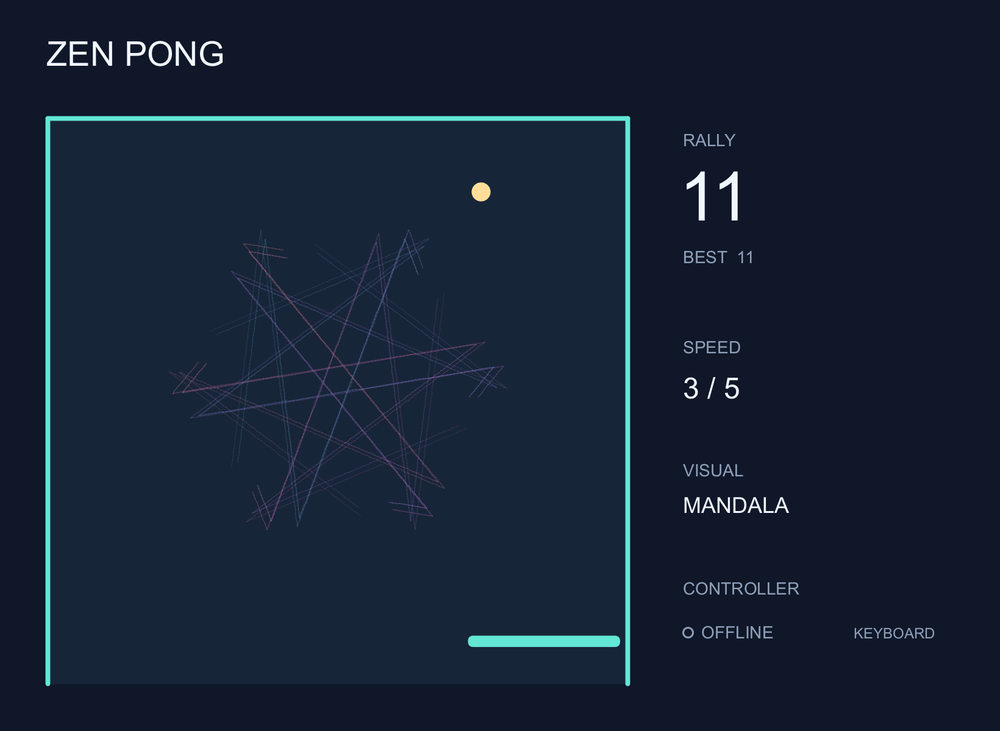
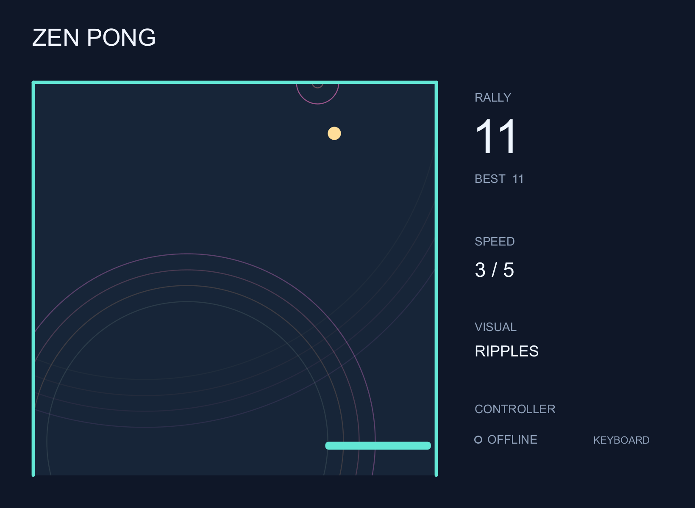
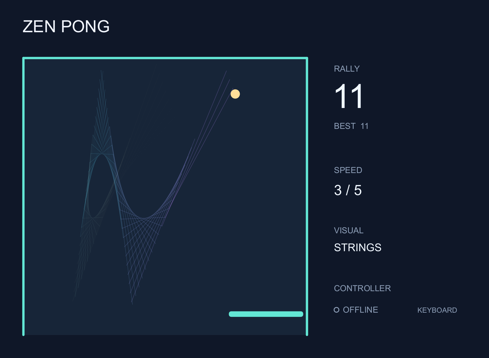
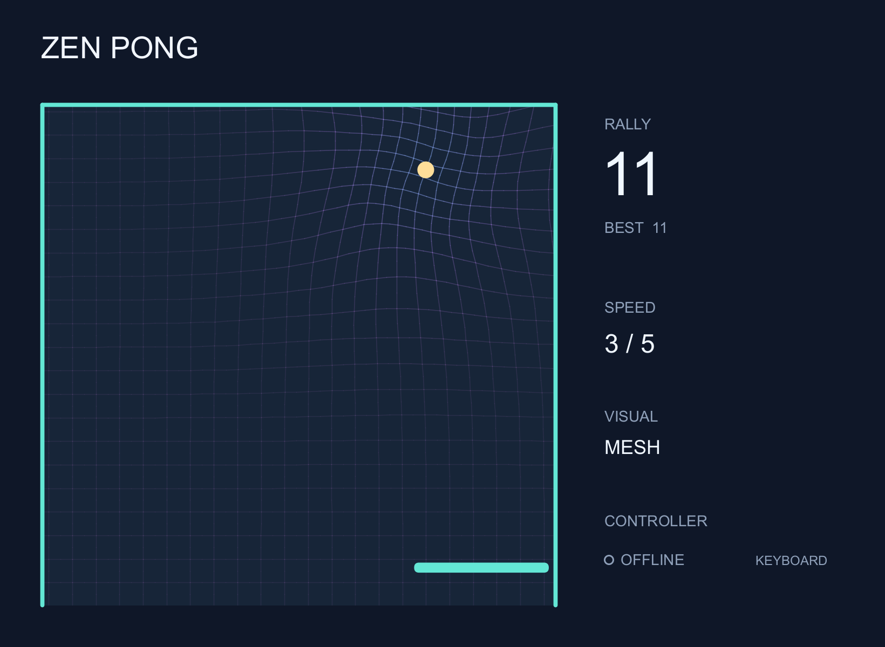

# Zen Pong

A single-player wall Pong game that turns ball trajectories and collisions into generative art. Built with Processing 4; play with a keyboard or an optional Arduino joystick controller.



One ball, one paddle, three walls. Keep a rally going at your own pace: choose one of five speeds, change the visual style, and pause whenever you like. The ball keeps its selected speed; there is no automatic acceleration.

## Play on your computer

1. Install [Processing 4](https://processing.org/download) and select **Java mode**.
2. Download or clone this repository. Open `processing/ZenPong/ZenPong.pde`, keeping all seven sketch files together in that folder.
3. Click **Run**, click the game window, then press **Enter**.

Arduino hardware is optional. The default configuration starts in keyboard mode. Processing's bundled Serial library is used; no additional Sound library is required. The game has been built and checked with Processing 4.5.7 on Windows; other desktop platforms have not been play-tested.

| Action | Keyboard | Arduino controller |
| --- | --- | --- |
| Move paddle | A / D or Left / Right | Joystick X |
| Start, pause, confirm | Enter or P | Joystick press |
| Select a pause-menu item | W / S or Up / Down | Joystick Y |
| Slower / faster | − / + (or =) | D4 / D5 buttons |
| Next visual | V | D6 button |
| Return to title and reset rally | R | Select **Title** while paused |
| PC volume down / up | [ / ] | — |
| Mute / unmute PC audio | M | — |
| Connect / cycle serial ports | C | — |
| Disconnect controller | X | — |

Esc or losing window focus pauses play. The pause menu also supports mouse clicks. Returning to the title clears the rally and best score while keeping the speed and visual selection. Scores are kept only for the current session.

## Four ways to see a rally

The visuals follow the ball's motion and impacts without changing the physics. Press **V** to cycle through them, including while paused.

| Ripples | Strings |
| --- | --- |
|  |  |
| Rings spread from each impact. | Lines connect points from different moments. |
| **Mandala** | **Mesh** |
|  |  |
| Rotational copies turn the trail into a pattern. | A continuous grid stretches around the ball. |

These screenshots were rendered from the game using scripted keyboard input, without a connected Arduino.

## Build the controller

Use an Arduino UNO R3 or compatible board, a two-axis joystick with a push switch, three momentary buttons, a passive piezo buzzer, a 10 kΩ potentiometer, a 330 Ω resistor, and a breadboard with jumper wires. These components are commonly included in Arduino starter kits; check the labels on your particular modules.

1. Follow the [hardware guide](docs/hardware.md), including both the breadboard view and schematic.
2. Upload `arduino/ZenPongController/ZenPongController.ino` with the Arduino IDE, selecting the UNO board and its port.
3. Close the Serial Monitor. Leave the joystick centered during board startup.
4. Run the game and press **C** to select the controller's serial port. Wait for **CONNECTED**.

The potentiometer adjusts **buzzer volume only**. PC audio has separate keyboard controls. For automatic connection, set `ARDUINO_PORT` in `ZenPong.pde` to your port name; it is empty by default. `INVERT_JOYSTICK_X` and `INVERT_JOYSTICK_Y` can reverse the axes for a different mounting orientation.

## Inside the repository

```text
processing/ZenPong/          Game, physics, visuals, serial link and PC audio
arduino/ZenPongController/   UNO firmware
hardware/                   Finished breadboard/schematic SVGs and Fritzing project
docs/                       Hardware, protocol and development guides; screenshots
tests/                      Physics, input, menu and visual-history checks
tools/                      Portable check runner
```

See [development and tests](docs/development.md) and the [serial protocol](docs/protocol.md). The sketch targets 60 frames per second with physics updates at 240 Hz. Speed levels are 220, 300, 400, 550 and 700 court pixels per second; level 3 is the default.

This is a personal creative project shared for others to play and explore. You are welcome to clone or fork it and make your own changes under the licenses below. I am not seeking contributions.

## License and credits

Original game code, firmware, tools, documentation and game screenshots are under the [MIT License](LICENSE). The finished controller SVGs and editable Fritzing project contain Fritzing-derived graphics and are under **CC BY-SA 3.0**, with separate [attribution and scope](THIRD_PARTY_NOTICES.md).

Processing, Arduino and Fritzing are separate projects with their own licenses. Their applications and runtimes are not bundled here.
