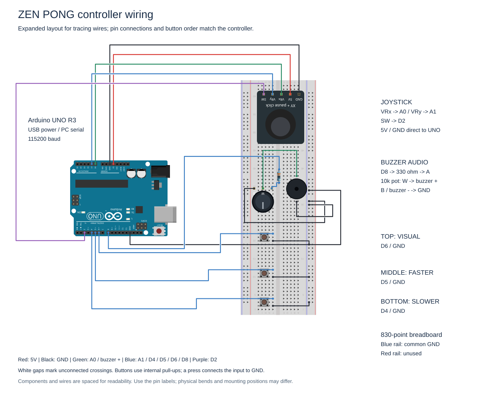
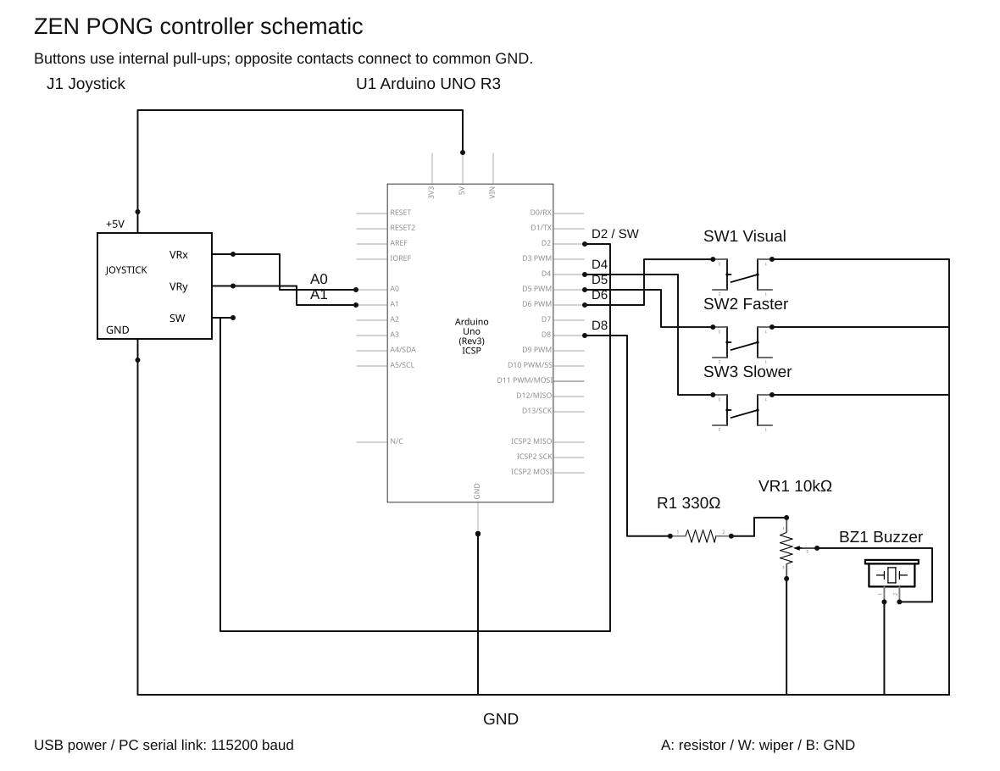

# Controller hardware

## Parts

| Part | Quantity | Notes |
| --- | --- | --- |
| Arduino UNO R3 or compatible | 1 | USB powered, 5 V logic |
| Two-axis analog joystick | 1 | GND, +5V, VRx, VRy, SW |
| Momentary push button | 3 | Slower, faster, next visual |
| Passive piezo buzzer | 1 | Use a passive piezo device, not an active buzzer or low-impedance speaker |
| Linear potentiometer | 1 | 10 kΩ, buzzer volume |
| Resistor | 1 | 330 Ω, in series with the audio output |
| Breadboard and jumper wires | 1 set | Diagram uses an 830-point breadboard |
| USB data cable | 1 | Power and serial connection |

Disconnect USB power before changing the wiring. Check the actual module labels; joystick pin order and button orientation can vary. The assembled controller mounts the UNO over the breadboard, rather than plugging it into the contact strips. Insulate its underside when mounting it. The diagram places the UNO beside the breadboard to make the connections easier to follow.

## Breadboard view

White gaps at wire crossings mean **no connection**. Dots at the wire ends mark connected terminals. The routing avoids shared line segments between different wires; crossing wires are still possible. The SVG is an annotated preview of the editable project.

The pin assignments and button order have been checked against the assembled controller. For readability, the diagram separates the UNO from the breadboard, spreads the audio components and buttons, and gives long wires separate routing lanes. Mounting positions, jumper rows and wire bends can differ from the compact physical assembly. The joystick's red 5V and black GND leads go **directly to the UNO power header**. A separate black lead from the **digital-header GND next to AREF** feeds the right-hand blue ground rail. The red power rail is unused.

The buttons are rotated so their two right-hand legs occupy different rows. From top to bottom, the assembly and diagram have **Visual (D6), Faster (D5), Slower (D4)**. In this expanded diagram, signal jumpers use F22, F12 and F4 respectively; ground jumpers use F20, F10 and F2. The corresponding button legs sit in column G, sharing each row's connected strip with F. The resistor is drawn as a five-band part beside the volume knob.

## Schematic

Both views are included in [ZenPongController.fzz](../hardware/ZenPongController.fzz). Open it in a standard Fritzing installation to inspect or edit the native views. The custom joystick, potentiometer and buzzer definitions and graphics are embedded in the project; other parts come from Fritzing's core library. No separate part download is needed. The project does not provide a PCB layout.

This image was created with Fritzing. Both diagrams and the Fritzing project are licensed under [CC BY-SA 3.0](../THIRD_PARTY_NOTICES.md).

## Pin map

| UNO pin | Connection |
| --- | --- |
| Power-header 5V | Direct to joystick +5V |
| Power-header GND | Direct to joystick GND |
| Digital-header GND, next to AREF | Common blue ground rail |
| A0 | Joystick VRx: paddle movement |
| A1 | Joystick VRy: vertical pause-menu selection |
| D2 | Joystick SW: start / pause / confirm |
| D4 | Slower button; opposite contact to GND |
| D5 | Faster button; opposite contact to GND |
| D6 | Next-visual button; opposite contact to GND |
| D8 | 330 Ω resistor, then potentiometer end A |
| GND | Potentiometer end B and buzzer negative |
| Potentiometer wiper W | Buzzer positive |

All four switches use `INPUT_PULLUP`: a press connects the input to GND and reads LOW. On a four-leg button, the two legs on one side may already be connected internally. Use opposite electrical contacts; check with a meter if unsure.

The potentiometer divides the D8 square-wave voltage. It controls the passive buzzer's amplitude independently of PC audio; do not omit the 330 Ω resistor. Swapping the two end terminals reverses the knob direction. There is no motor or motor driver.

## Firmware and connection

1. In the Arduino IDE, open `arduino/ZenPongController/ZenPongController.ino`.
2. Select **Arduino UNO** and the board's serial port, then upload. No additional Arduino libraries are required.
3. Close the Serial Monitor and any other application using that port.
4. Let the joystick rest at the center during boot. The firmware averages 32 samples for calibration.
5. Run the Processing sketch, focus its window, and press **C** to select a port. If several ports are listed, C cycles through them. Opening a UNO port normally resets the board, so allow a few seconds for identification.

`CONTROLLER` shows **OFFLINE / KEYBOARD** when disconnected, **WAITING** while identifying a board, and **CONNECTED** only after valid recent input. The game does not scan or open ports automatically by default. To select a known port on startup, edit `ARDUINO_PORT` in `ZenPong.pde`.

Tilt Y to select **Resume** or **Title** while paused, then press the stick to confirm. Return the stick to center between selections. If the axes are reversed for your mounting orientation, change the corresponding `INVERT_JOYSTICK_*` flag in the sketch.

## Troubleshooting

| Symptom | Check |
| --- | --- |
| OFFLINE after pressing C | USB data cable, selected port, permissions and whether the Serial Monitor owns the port. On Linux, serial access may require membership in the appropriate device-access group. |
| WAITING, then OFFLINE | Upload the matching firmware: it identifies itself as `READY,ZENPONG,3`. Other Arduino sketches will not connect. |
| Connected, but no movement | Click the game, start with the stick press or Enter, then check VRx → A0 and common GND. |
| Pause-menu selection does not move | Check VRy → A1, return the stick to neutral, then tilt vertically. |
| No buzzer sound | Increase the physical volume, check D8, the resistor and wiper wiring, and confirm a passive buzzer is fitted. The title has a repeating melody; impacts play during a rally. |
| No PC sound | Press M, increase volume with ], and check the computer's audio output. PC audio approximates the buzzer waveform. |
| Button does nothing | Release before pressing again; verify opposite electrical contacts and the D4 / D5 / D6 mapping. |

The [protocol guide](protocol.md) describes packet validation and timeouts. A successful firmware build does not verify the physical wiring.
